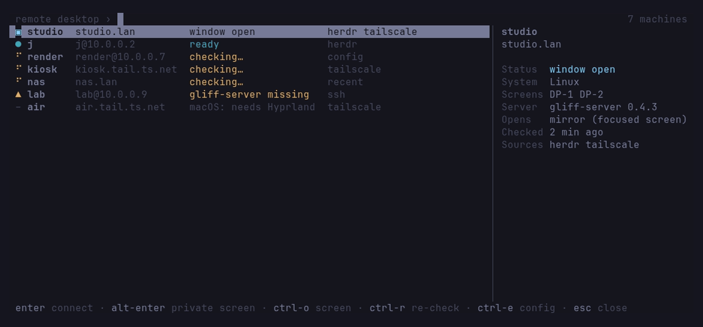

# gliffherdr

[](https://github.com/jaden-hoenes/gliffherdr/actions/workflows/ci.yml)
[](https://github.com/jaden-hoenes/gliffherdr/releases/latest)
[](LICENSE)
[](https://herdr.dev)

Open a remote desktop to any machine you can ssh to, from a picker inside herdr.



- Lists every machine you already have: herdr machines, `~/.ssh/config`, Tailscale, gliff, and ones you type.
- Checks each one over ssh and tells you what is wrong and how to fix it.
- Opens each machine in its own [gliff](https://github.com/omacom/gliff) window, or focuses the window if it is already open.

## Install

You need, on your machine:

- Linux with Hyprland (Omarchy works out of the box)
- [gliff](https://github.com/omacom/gliff): `omarchy pkg add gliff`
- `ssh`
- [herdr](https://github.com/herdrdev/herdr) 0.9.0 or newer

On each machine you want to open:

- Hyprland, with a session running
- `gliff-server` (gliffherdr can install it for you, see below)
- ssh login with a key, no password prompt

Install the plugin:

```sh
herdr plugin install jaden-hoenes/gliffherdr
```

herdr shows what it is about to run and asks first. The build step is `scripts/install.sh`. It
downloads the prebuilt static binary for this version from the GitHub release, checks its SHA-256
against the release's `SHA256SUMS`, and puts it in the plugin's `bin/`; it does not need Rust. If
the repository is private to you, the download goes through your logged-in `gh` CLI. Only
if that release file is missing or fails the checksum, and `cargo` is installed, does it build from
source with `cargo build --release --locked` instead. If neither works it stops and says why.
`GLIFFHERDR_BUILD=source` (or `prebuilt`) forces one way.

Bind a key. Add this to `~/.config/herdr/config.toml`, then run `herdr server reload-config`:

```toml
[[keys.command]]
key = "prefix+alt+r"
type = "plugin_action"
command = "jaden-hoenes.gliffherdr.connect"
description = "Remote desktop"
```

Optional: a second key that opens the machine the focused pane is ssh'd into (and the picker when
the pane is not running ssh):

```toml
[[keys.command]]
key = "prefix+alt+shift+r"
type = "plugin_action"
command = "jaden-hoenes.gliffherdr.connect-pane"
description = "Remote desktop: this pane's machine"
```

The plugin never edits your herdr config.

## Use

Press your key. The picker opens as a popup. Type to filter, press Enter to connect.

| Key | Does |
|---|---|
| type | filter by name, address or source (fuzzy) |
| `↑` `↓` `Ctrl+P` `Ctrl+N` | move the selection |
| `Enter` | connect, using the machine's own screen setting |
| `Alt+Enter` | connect with a private screen sized to the window |
| `Ctrl+O` | choose the screen: mirror the focused one, mirror a named one, or a private one |
| `Ctrl+F` | fix the selected machine (shown only when it needs setup and there is a fix) |
| `Ctrl+R` | check every machine again |
| `Ctrl+E` | edit `config.toml` |
| `Esc` | close the error panel, then clear the filter, then close the picker |

To open a machine that is not listed, type its address (`user@host`, an ssh alias or
`ssh://user@host:2222`) and press Enter on the `↵ connect to …` row.

Each row says what a connect would do:

| Row | Meaning |
|---|---|
| `▣ window open` | a gliff window is already open; Enter focuses it |
| `● ready` | Hyprland is running there and `gliff-server` is installed |
| `⠋ checking…` | the check is running; rows update in place and do not jump |
| `○ not checked` | no result yet |
| `▲ gliff-server missing`, `ssh key refused`, `unknown host key`, `Hyprland not running` | needs setup; select it for the explanation, `Ctrl+F` for the fix |
| `✕ offline` | ssh could not reach it |
| `– macOS: needs Hyprland` | not a Hyprland machine; listed, never contacted |

The picker also runs in any terminal: `gliffherdr pick`. Try it with made-up machines:
`GLIFFHERDR_DEMO=1 gliffherdr pick`.

## Where machines come from

A machine named by several sources is listed once and its row shows every source.

| Source | What it lists |
|---|---|
| `herdr` | machines saved in herdr (`herdr machine list`) |
| `ssh` | `Host` entries of `~/.ssh/config` and the files it includes (not wildcards, not git hosts such as github.com) |
| `tailscale` | online Linux peers of your tailnet; macOS and Windows peers are listed as unsupported |
| `gliff` | machines in gliff's own config |
| `recent` | machines you connected to before (the last 30) |
| `config` | `[[machine]]` entries in `config.toml` |

Each source can be switched off, and any machine can be hidden. See [Configuration](#configuration).

## Configuration

Settings live in one file, `config.toml`. Every key is optional.

```toml
[connect]
mode = "mirror"                     # what Enter opens: "mirror" or "headless"

[sources]
tailscale = false                   # do not list Tailscale peers
hide = ["backup-nas", "nas.lan"]    # never list these (by target or label)

[[machine]]                         # settings for one machine
target = "render@10.0.0.7"
label = "render"
output = "DP-2"                     # always mirror this remote screen

[[machine]]
target = "lab@10.0.0.9"
mode = "headless"                   # always open a private screen
```

`gliffherdr config init` writes a commented template and prints its path; `gliffherdr config check`
validates the file. In the picker, `Ctrl+E` opens it in `$VISUAL` or `$EDITOR`.
Every key, the file locations and the environment variables are in
[docs/configuration.md](docs/configuration.md).

## How it works

- **One ssh call per check.** It feeds a short POSIX `sh` script to the machine and reads back the
  OS, whether Hyprland runs, its screens and whether `gliff-server` is there. Nothing is installed
  on the machine.
- **Results are cached** for 10 minutes. Checks run when herdr starts (not for Tailscale-only
  machines), when the picker opens (stale machines only), on `Ctrl+R`, and before connecting.
- **One window per machine.** gliff reopens every machine in its own config, so each window gets a
  private gliff config and never shows tabs of other machines. Connecting to a machine whose window
  is open focuses it.
- **Launched like Omarchy launches apps**: through `uwsm-app` when your session uses uwsm, otherwise
  in its own session with `setsid`. The window's log is kept per machine.
- **Host keys follow gliff.** An unknown host key is accepted on first contact exactly when gliff
  would accept it; a changed key always fails and is never fixed for you.

More in [docs/how-it-works.md](docs/how-it-works.md).

## Command line

The picker is the main interface; the same things work from a shell.

```sh
gliffherdr list                     # machines with their last known status
gliffherdr list --json              # the same as JSON, for scripts
gliffherdr check --all              # check every machine now
gliffherdr connect j@10.0.0.2       # open a machine, or focus its window
gliffherdr connect --headless j@10.0.0.2
gliffherdr fix lab@10.0.0.9         # install gliff-server, copy the ssh key or accept the host key
gliffherdr doctor                   # is this machine set up to open windows?
```

`gliffherdr --help` and `gliffherdr <command> --help` list everything. herdr installs the binary
into the plugin's own directory (`herdr plugin list` shows where). To have it on your `PATH`,
symlink it from there, or run
`cargo install --locked --git https://github.com/jaden-hoenes/gliffherdr`. A shell and the plugin
share the same config and cache.

Without `--check`, `list` makes no ssh connection: it shows what the last check found.

## Troubleshooting

[docs/troubleshooting.md](docs/troubleshooting.md) has a section for every status. The common ones:

- **ssh key refused.** gliff needs key login without a prompt. Select the machine and press
  `Ctrl+F` (runs `ssh-copy-id`), or run `gliffherdr fix <target>`.
- **gliff-server missing.** Select the machine and press `Ctrl+F`. It runs
  `omarchy pkg add gliff` on the machine, which needs an Omarchy there. Otherwise install gliff on
  that machine yourself, or point `server_bin` in `config.toml` at the binary.
- **Hyprland not running.** gliff mirrors a running session. Log in at the machine, then press
  `Ctrl+R`.

When nothing else explains it, run `gliffherdr doctor` and attach its output to an issue.

## Development

```sh
git clone https://github.com/jaden-hoenes/gliffherdr
cd gliffherdr
scripts/vendor.sh        # gliff and herdr sources the contract tests read (into .vendor/)
scripts/dev-link.sh      # build and link this checkout into herdr
scripts/gate.sh          # everything CI runs
```

See [CONTRIBUTING.md](CONTRIBUTING.md).

## Credits

[gliff](https://github.com/omacom/gliff) is made by omacom. [herdr](https://github.com/herdrdev/herdr)
is made by herdrdev. gliffherdr connects the two and is not affiliated with either.

## Licence

[MIT](LICENSE). Third-party licences of the release binary are in `THIRD_PARTY_LICENSES.html` in
the release tarball.
